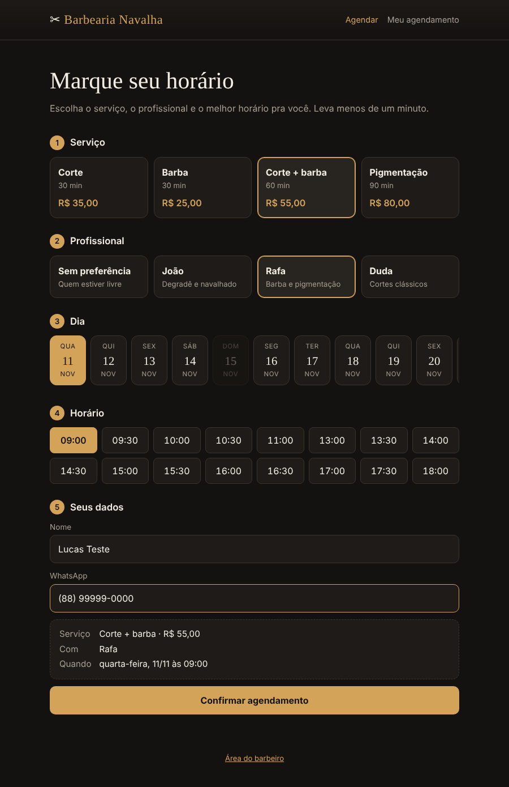
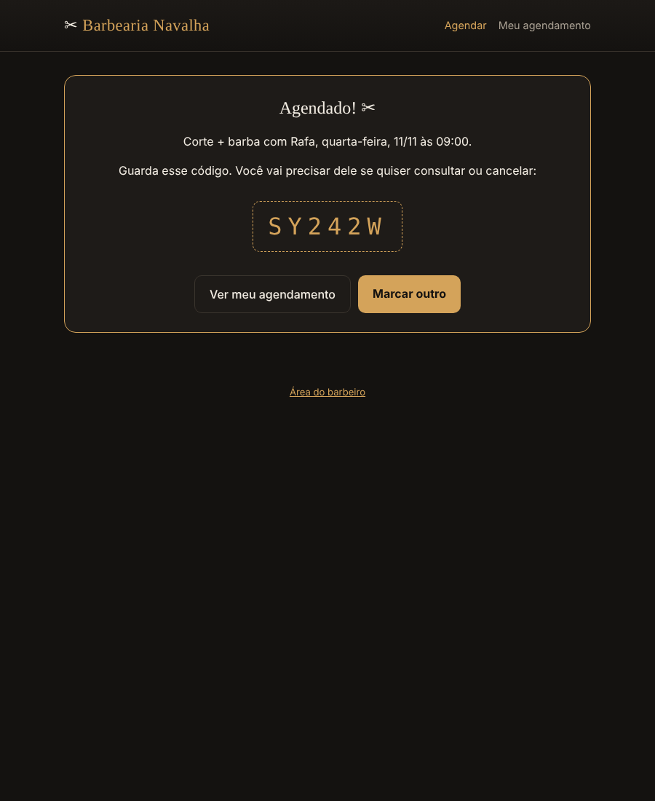
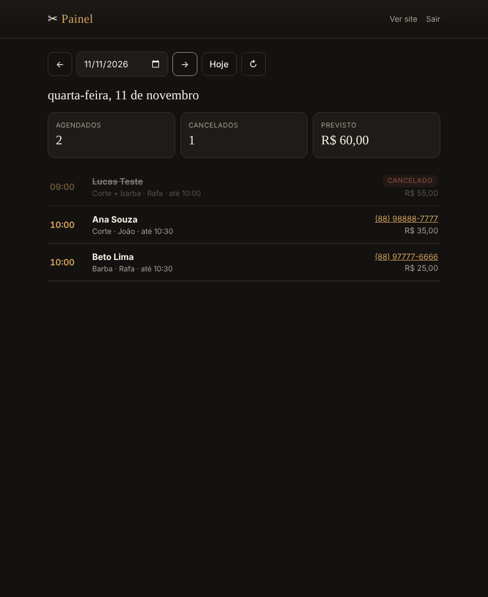

# ✂ Barbearia: agendamento online

Sistema de agendamento para barbearia. O cliente escolhe o serviço, o profissional,
o dia e um horário livre, e recebe um **código** para consultar ou cancelar depois.
O barbeiro tem um **painel** com a agenda do dia e o faturamento previsto.

Feito com **Node.js + Express + SQLite** no back-end e **HTML, CSS e JavaScript puro**
no front-end.



## ✨ Funcionalidades

**Para o cliente**
- Agendamento em 5 passos: serviço → profissional → dia → horário → dados
- Só aparecem horários realmente livres, considerando a **duração de cada serviço**
  (um combo de 60 min não aparece às 11:30 se o almoço começa ao meio-dia)
- Opção **"Sem preferência"**: o sistema escolhe o barbeiro que estiver livre
- Código de 6 caracteres para consultar e cancelar, sem precisar de login
- Os últimos códigos ficam salvos no aparelho para achar fácil

**Para o barbeiro**
- Painel protegido por senha com a agenda do dia
- Total de agendados, cancelados e faturamento previsto
- Telefone do cliente com link direto para o WhatsApp

**Regras de negócio**
- Horário de funcionamento por dia da semana, com intervalo de almoço
- Domingo fechado; horários que já passaram não aparecem
- Agendamento com até 30 dias de antecedência
- Cancelamento só até **2h antes** (funciona até virando o dia)
- No máximo **2 agendamentos ativos** por telefone
- Dois clientes não conseguem pegar o mesmo horário, nem clicando ao mesmo tempo

| Confirmação | Painel do barbeiro |
|---|---|
|  |  |

## 🚀 Como rodar

Precisa do **Node.js 20** ou mais novo.

```bash
npm install
npm start
```

- Site: http://localhost:3000
- Painel: http://localhost:3000/admin.html (senha padrão: `admin123`)

Para trocar a senha do painel:

```bash
ADMIN_SENHA=minhasenha npm start          # Linux / macOS
$env:ADMIN_SENHA="minhasenha"; npm start   # Windows (PowerShell)
```

Durante o desenvolvimento, `npm run dev` reinicia o servidor sozinho quando
você salva um arquivo.

## 🧪 Testes

```bash
npm test
```

São **24 testes** com o test runner nativo do Node (`node:test`), sem instalar
nada a mais:

- `test/agenda.test.js`: o cálculo de horários livres (funções puras)
- `test/api.test.js`: a API de ponta a ponta. Sobe o servidor de verdade, com
  banco em memória e um **relógio falso**, para testar regras como "não cancela
  com menos de 2h" sem depender da hora atual

## 🔌 API

| Método | Rota | O que faz |
|---|---|---|
| `GET` | `/api/informacoes` | Nome, serviços, barbeiros e horário de funcionamento |
| `GET` | `/api/horarios?data=&servicoId=&barbeiroId=` | Horários livres (`barbeiroId=qualquer` junta todos) |
| `POST` | `/api/agendamentos` | Cria um agendamento |
| `GET` | `/api/agendamentos/:codigo` | Consulta pelo código |
| `DELETE` | `/api/agendamentos/:codigo` | Cancela (o registro fica no histórico) |
| `GET` | `/api/admin/agenda?data=` | Agenda do dia (header `x-admin-senha`) |

Exemplo:

```bash
curl -X POST http://localhost:3000/api/agendamentos \
  -H "content-type: application/json" \
  -d '{"nome":"Lucas","telefone":"88999990000","servicoId":"corte","barbeiroId":"qualquer","data":"2026-11-12","hora":"10:00"}'
```

Os erros sempre voltam como `{ "erro": "mensagem" }`, com o status certo: `400`
para dado inválido, `404` para não encontrado, `409` para conflito
(horário ocupado, limite atingido) e `401` para senha errada.

## 🗂️ Estrutura

```
src/
├── config.js       # nome, serviços, barbeiros, horários e regras
├── tempo.js        # datas, horas e fuso horário
├── agenda.js       # cálculo de horários livres (funções puras)
├── repositorio.js  # acesso ao SQLite
├── servico.js      # regras de negócio
├── app.js          # rotas HTTP (Express)
└── server.js       # liga tudo e sobe o servidor
public/             # front-end: index (agendar), agendamento (consultar/cancelar), admin
test/               # testes automatizados
```

## 🧠 Decisões de projeto

- **Camadas separadas.** `agenda.js` não sabe que existe banco; `servico.js`
  não sabe que existe HTTP; `app.js` só traduz requisição em chamada de
  serviço. Cada parte é testável sozinha.
- **Horário como minutos.** `09:30` vira `570`. Somar duração e checar
  sobreposição vira conta simples: `a.inicio < b.fim && b.inicio < a.fim`.
- **Fuso horário explícito.** "Agora" é sempre calculado no fuso da barbearia
  (`America/Fortaleza`), mesmo que o servidor esteja hospedado em outro país.
- **Sem condição de corrida.** A checagem de conflito e o `INSERT` rodam na
  mesma transação do SQLite. Se dois clientes confirmarem o mesmo horário ao
  mesmo tempo, só um consegue.
- **O back-end não confia no front.** Mesmo que alguém mande pela API um
  horário fora do expediente ou fora da grade, o servidor recusa.
- **Preço congelado.** O valor é salvo no agendamento. Se o preço mudar
  depois, quem já marcou paga o combinado.
- **Cancelar não apaga.** O agendamento só muda de status, então o histórico
  continua disponível para o painel.
- **Segurança básica.** SQL com parâmetros (sem SQL injection), textos
  inseridos com `textContent` (sem XSS), senha comparada em tempo constante e
  limite de tamanho no corpo das requisições.

## 🔧 Adaptando para outro negócio

Toda a parte "de barbearia" está em `src/config.js`. Para virar um consultório
ou uma quadra de futebol, basta trocar serviços, profissionais (ou quadras),
horários e regras ali. O resto do código continua igual.

## 🛣️ Próximos passos

- [ ] Lembrete automático por WhatsApp ou e-mail na véspera
- [ ] Bloquear dias de folga e feriados por barbeiro
- [ ] Login de verdade no painel (usuário + senha com hash)
- [ ] Deploy (Render, Railway ou Fly.io)
